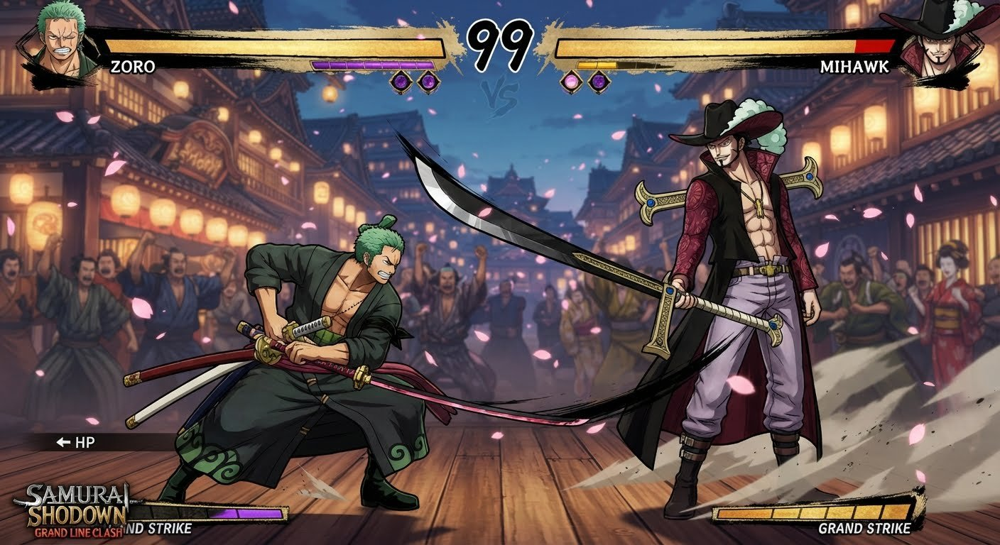

# One Piece Shodown

A Samurai Shodown style 2D fighting game with One Piece characters, made in Godot 4. It is a fan project for personal, local play.

All art, effects, stages, sound and music are generated by code. Fighters are drawn as animated, cel-shaded anime-style rigs with muscle shapes, cloth folds, flowing hair and coats, rim lighting from each stage and three-quarter faces. Stages are painted parallax layers made by `tools/gen_stages.py`, and the audio is synthesized by `tools/gen_audio.py`.

## Gameplay

<video src="docs/gameplay.mp4" controls width="100%"></video>

[Watch the gameplay video](docs/gameplay.mp4)

## Play on macOS

1. Install Godot 4.3 or newer (the standard build, not .NET). Either:
   - `brew install --cask godot`, or
   - download it from https://godotengine.org/download/macos/ and drag it to Applications.
2. Clone the game:
   ```sh
   git clone https://github.com/onmyway133/onepiece-shodown.git
   ```
3. Open Godot, click **Import**, choose `onepiece-shodown/project.godot`, then **Import & Edit**. The first import takes a few seconds.
4. Press **Cmd+B** (or the ▶ Play button at the top right) to start the game.

Press **F11** or **Cmd+Enter** to toggle fullscreen.

To play without the editor afterwards:
```sh
/Applications/Godot.app/Contents/MacOS/Godot --path ~/path/to/onepiece-shodown
```

## Modes

- **VS CPU**: pick your pirate, then your opponent, then a stage. Set the CPU level on the title screen (Easy, Normal, Hard, Pirate King).
- **VS Player 2**: two players on one keyboard, or with gamepads.
- **Training**: free practice against a dummy. Health refills and your rage gauge fills up so you can try supers.
- If you leave the title screen alone, a CPU vs CPU demo starts. Press any button to return.

## Controls

| | Player 1 | Player 2 |
|---|---|---|
| Move, jump, crouch | W A S D | Arrow keys |
| Light attack | F or J | `,` or Numpad 1 |
| Heavy attack | G or K | `.` or Numpad 2 |
| Kick | H or L | `/` or Numpad 3 |
| Special | T or I | `;` or Numpad 4 |
| Super | Y or U | `'` or Numpad 5 |
| Pause | Esc or Enter | Esc or Enter |

Gamepad 1 controls P1 and gamepad 2 controls P2: X light, Y heavy, A kick, B special, RB/LB super, Start pause. In VS CPU mode both keyboard halves control Player 1, so you can play with arrows and `, . /` too.

- **Block**: hold away from your opponent. Hold down-back to block low attacks. Jumping attacks must be blocked standing.
- **Dash**: tap forward twice. Tap back twice to backstep.
- **Specials**: either press **Special** with a direction, or use the classic motions:
  - Special or QCF + attack (down, down-forward, forward)
  - Back + Special or QCF + Heavy for the heavy version
  - Forward + Special or QCB + attack (down, down-back, back)
  - Up + Special or DP + attack (forward, down, down-forward)
- **Extra specials**: every fighter has three more specials.
  - QCB + Heavy and DP + Heavy (heavy versions of those two motions)
  - Down + Special, or HCF + attack (back, down-back, down, down-forward, forward)
- **Throw**: close to a standing opponent, press forward or back + Heavy. Throws can't be blocked.
- **Grand Strike gauge**: taking hits fills the 5-part POW gauge. At RAGE MAX you deal 30% more damage for a while and can use a super:
  - **Super**: Super button, or Special + Heavy
  - **Second super**: Back + Super, or QCB twice + attack
- Light attacks can cancel into heavy, kick, or specials when they hit.

The pause menu has a **Move List** for both fighters.

## Roster

| Fighter | Style | Specials | Supers |
|---|---|---|---|
| **Luffy** | Rubber stretch punches, long reach | Pistol, Bazooka, Gatling, Ono, Muchi, Rocket, Stamp | Gear Second: Jet Gatling, Gear Third: Gigant Pistol |
| **Zoro** | Three sword style, huge sword damage | 36 / 108 Pound Phoenix, Oni Giri, Tatsumaki, Taka Nami, Tora Gari, Shishi Sonson | Ashura: Ichibugin, Sanzen Sekai |
| **Sanji** | Fast kicks, flaming Diable Jambe | Premier Hache, Concassé, Party Table, Anti-Manner, Grill Shot, Collier, Veau Shot | Hell Memories, Boeuf Burst |
| **Ace** | Fire zoning | Hiken, Jujika, Hotarubi, Hibashira, Higan, Kagero, Hidaruma | Dai Enkai: Entei, Fire Fist Barrage |
| **Mihawk** | Long-range black slashes, counters | Yoru, Kurotoga, Flash Step, Rising Yoru, Kogatana, Senki counter, Ichimonji | Saikyo no Zangeki, Tsubame Gaeshi |
| **Law** | ROOM tricks and teleports | Amputate, Injection Shot, Shambles, Takt, Counter Shock, Radio Knife, Mes | Gamma Knife, Puncture Wille |
| **Nami** | Fast weather zoner | Thunder Ball, Thunder Lance, Cyclone, Thunderbolt, Mirage, Tornado, Black Ball | Zeus Breeze Tempo, Raitei |
| **Jinbe** | Heavy grappler, water karate | Gosenmaigawara, Uchimizu, Samegawara, Yarigawara, Mizu Gokoro, Water Pillar, Kairyu Ippon Zeoi (command throw) | Buraikan, Murasame |

Stages: Going Merry at sunset, Wano sakura shrine, Alabasta at night, and the Wano Flower Capital at night: a lantern-lit street with a cheering crowd.

### Final stage

The Flower Capital stage was built from this concept image (it is not a screenshot from the game).



## Project layout

- `scripts/chars/`: one file per fighter (body proportions, colors, poses, moves and drawing), built on `char_data.gd`.
- `scripts/fight/`: fighter state machine, hit detection, projectiles, effects, stage, CPU AI and match flow.
- `scripts/ui/`: title, character and stage select, HUD and menus.
- `tools/`: Python generators for stages and audio (`pip install numpy pillow scipy`, needs `ffmpeg` for the music).
- `tests/test_core.gd`: headless checks, run with `godot --headless --path . --script res://tests/test_core.gd`.

### Adding a fighter

Copy `scripts/chars/luffy.gd`, change the dims, colors, poses and moves, add its id to `ROSTER` in `scripts/core/game.gd`, and it shows up in character select. Moves are lists of keyframed poses plus hit windows. The rig turns them into smooth animation and hitboxes automatically.

### Developer screenshots

`godot --path . -- --debug=poses --char=zoro --shot=/tmp/zoro.png` renders a pose sheet. `--debug=fight --p1=luffy --p2=ace --shots=300,600 --quit=900 --shot=/tmp/f.png` plays a CPU vs CPU fight and saves screenshots.
